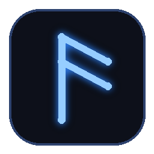
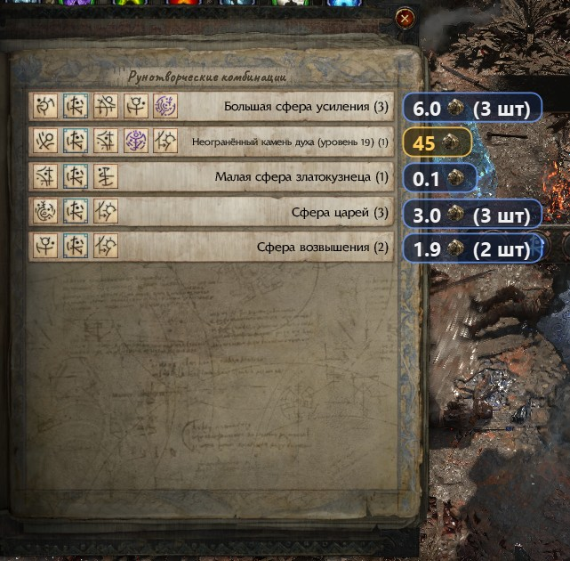
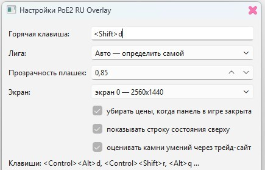

# Westrit PoE2 Overlay

<p align="center"></p>

Русский оверлей цен для **Path of Exile 2**. Читает открытую панель наград
Эзомитского останка («Сочетания рун») и показывает стоимость каждой награды
прямо рядом с ней — чтобы выбирать не наугад, а по цене.

Русский интерфейс, распознавание русского текста, словарь названий RU→EN и
источники цен под русскую лигу — собственная часть этой версии.

> **Только чтение.** Оверлей делает снимок окна игры, распознаёт текст и рисует
> своё окно поверх. Он не читает память игры, не нажимает клавиши за вас и не
> трогает клиент. Официальной поддержки нет — правила GGG к сторонним
> программам строгие, используйте на свой риск.

## Как это выглядит

<p align="center"></p>

Слева — панель наград в игре, справа — плашки оверлея. Золотая плашка — самая
дорогая награда в списке. В скобках — общая стоимость с учётом количества.

<p align="center"></p>

## Что умеет

| | |
|---|---|
| Цены у каждой награды | экзальты/божественные, с иконкой валюты |
| Лучший вариант | подсвечивается золотым |
| Награда без цены | помечается `?` — цена не выдумывается никогда |
| Бонусная награда | показывается отдельно и не участвует в сравнении |
| Клавиша | `Shift+D` — показать/скрыть цены у открытой панели |
| Срабатывание | только когда активное окно — игра; в других программах `Shift+D` работает как обычно |
| Настройки | значок в трее → «Настройки…»: лига, клавиша, автозакрытие |

Подробности — как распознаётся панель, откуда берутся цены, почему полный
проход занимает 10–20 минут и что писать в журнале — в файле
[«Как это работает»](docs/how-it-works.md).

## Откуда цены

Порядок проверки для каждого предмета:

1. базовая цена poe.ninja (для текущей лиги);
2. официальный снимок — только если он **ниже** базы;
3. poe2scout — только если там есть достаточный объём;
4. живые лоты торгового сайта — только если они не выше базы.

Итоговая цена никогда не оказывается выше базовой: оверлей не завышает.
Если ни один источник не дал подтверждённой цены — строка остаётся без цены.

## Требования

| | |
|---|---|
| ОС | Windows 10/11 x64 (распознавание — через `Windows.Media.Ocr`) |
| Клиент игры | русский, окно или «окно без рамки» |
| Python | 3.11+ — только если запускаете из исходников |

## Установка

### Готовый файл (Python не нужен)

1. Откройте раздел **Releases** и скачайте `WestritPoeOverlay.exe`.
2. Запустите. Windows покажет предупреждение (файл не подписан сертификатом):
   «Подробнее» → «Выполнить в любом случае». Дальше система его запомнит.
3. В трее появится значок оверлея.

### Из исходников

```bat
git clone https://github.com/lannonrehberg-collab/WestritPoeOverlay.git
cd WestritPoeOverlay
py -m venv .venv
.venv\Scripts\activate
pip install -e ".[vision,overlay,ru]"
run_ru_overlay.bat
```

`run_ru_overlay.bat` поднимает оверлей и хранит настройки, кэш цен и журнал в
папке `runtime\` рядом с проектом.

## Как пользоваться

1. Откройте в игре панель наград Эзомитского останка.
2. Нажмите `Shift+D` (окно игры должно быть активным).
3. Рядом с каждой наградой появится цена; лучшая — золотая.
4. `Shift+D` ещё раз — скрыть.

Настройки — правый клик по значку в трее. Там же кнопка «Открыть папку с
логом», если что-то не читается.

## Ограничения

- Работает только на Windows: чтение текста идёт через системный OCR.
- Настроен на русский клиент. Английские названия понимает частично —
  словарь и шаблоны панели сделаны под русский интерфейс.
- Награда, которой нет в каталоге предметов, показывается без цены (`?`).
  Это честнее, чем подставить цену похожего предмета.
- Панель должна быть видна целиком: перекрытие другими окнами или всплывающие
  подсказки могут помешать распознаванию.

## Поддержать проект

Оверлей бесплатный, исходники открыты. Если он экономит вам время, разработку
можно поддержать — по желанию, за деньги не закрывается ни одна функция.

- **Boosty** — <https://boosty.to/westrit> (там же новости и сборки)
- **Telegram** — [@VolmondPRO](https://t.me/VolmondPRO)
- **ВКонтакте** — <https://vk.com/westrit>
- **Facebook** — <https://www.facebook.com/westrit>

## Лицензия

MIT — см. [LICENSE](LICENSE). В этом файле перечислены правообладатели:
часть базовых модулей унаследована от проекта, с которого начинался этот
репозиторий, остальное написано заново.
